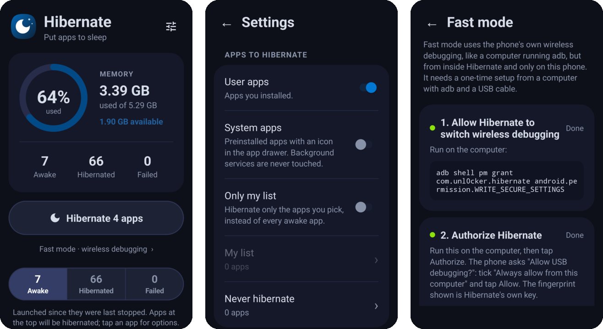

# Hibernate

Puts Android apps to sleep. Hibernate force-stops the apps that are running in the background,
so they stop using memory, battery and data until you open them again.



- **One tap** hibernates every awake app, or tap the moon next to a single app.
- **Memory dashboard** with used and available memory, and lists of awake, hibernated and
  failed apps (pull down to refresh).
- **Quick Settings tile** to hibernate from anywhere.
- **Hibernate when the screen turns off**, after a delay you choose.
- **Your rules**: hibernate user apps, system apps, or only the apps in your own list, and
  keep a list of apps that are never hibernated.
- **Backup and restore** of your lists and options as a small JSON file.
- No ads, no tracking, nothing leaves the phone.

## What hibernating means

Hibernating an app is Android's **Force stop**. A stopped app does not run at all until
something starts it again, usually you opening it. While stopped it receives **no
notifications, alarms or background syncs**. Keep messengers, alarm clocks and anything else
you need to hear from in the **Never hibernate** list.

Some apps are always kept awake, because stopping them would break the phone or switch them
off until you set them up again: the keyboard, the home screen, the default phone and
messaging apps, apps with an Accessibility service or notification access, the live
wallpaper, device admin apps and core system components. They show greyed out in the list,
with the reason underneath.

## How it stops apps

Android only lets the system and adb (the debugging bridge) force-stop other apps. Hibernate
has two ways to get there.

### Fast mode (wireless debugging)

Hibernate contains a small adb client of its own. It connects to the phone's **own** wireless
debugging service on `127.0.0.1`, authenticated with its own key, and runs
`am force-stop <package>` for each app. A run takes about two seconds, shows nothing on
screen and also works with the screen off.

- Wireless debugging is switched on only for the run and off again afterwards (unless it was
  already on). The port is found through the phone's own mDNS announcement.
- Wireless debugging only runs on **Wi-Fi**. Without Wi-Fi, Hibernate uses accessibility mode.
- On Android 11 and 12 the phone forgets which networks are allowed for wireless debugging at
  every reboot and asks "Allow wireless debugging on this network?" again. With the
  Accessibility service on, Hibernate presses **Allow** by itself, only during the seconds
  right after it turned wireless debugging on.
- Fast mode needs a one-time setup from a computer (see below).

### Accessibility mode (fallback)

Without fast mode, Hibernate opens each app's **App info** page and presses **Force stop**
and **OK** through its Accessibility service. A progress screen covers the Settings pages
while it works. After the screen turns off it wakes the screen dimmed and dark, works, and
locks it again. This takes about a second per app.

The Accessibility service is limited to the Settings app and System UI. It finds the buttons
by their resource IDs (`com.android.settings:id/button3` for Force stop, `android:id/button1`
for OK), which do not depend on the phone's language.

## Compatibility

Android 11 or newer (wireless debugging appeared in Android 11).

| Device | Firmware | Fast mode | Accessibility mode | Screen off |
|---|---|---|---|---|
| Galaxy S10e | One UI 4.1, Android 12 | yes | yes | yes |

Fast mode uses standard Android services and should work on any Android 11+ phone.
Accessibility mode depends on the layout of the Settings app; phones whose App info page uses
different button IDs may need adjustments. Reports from other devices are welcome.

## Install and setup

1. Download `hibernate-<version>.apk` from the [Releases](../../releases) page and install
   it (`adb install hibernate-<version>.apk`, or open the file on the phone).
2. Open Hibernate, tap **Open Accessibility settings** and turn Hibernate on. On Android 13
   and newer, sideloaded apps first need App info > menu (three dots) > **Allow restricted
   settings**.
3. Set up fast mode once, with the phone connected to a computer with adb and USB debugging
   on. In Hibernate, tap the line under the big button to open the **Fast mode** screen, then:
   1. Allow Hibernate to switch wireless debugging:
      ```
      adb shell pm grant com.unl0cker.hibernate android.permission.WRITE_SECURE_SETTINGS
      ```
   2. Put adb in TCP mode so Hibernate can offer its key:
      ```
      adb tcpip 5555
      ```
      Tap **Authorize**. The phone asks "Allow USB debugging?" and shows a fingerprint: that is
      Hibernate's own key. Tick **Always allow from this computer**, then tap **Allow**.
      Hibernate switches adb back to USB mode by itself.
   3. Tap **Test fast mode** (Wi-Fi needed). It should say "Working".

If you later use **Revoke USB debugging authorizations** in Developer options, Hibernate's key
is removed as well: repeat step 3.2. Turning off USB debugging or Developer options also
disables fast mode until they are back on.

## Permissions

| Permission | Why |
|---|---|
| `QUERY_ALL_PACKAGES` | list installed apps and see which ones are awake |
| `INTERNET` | fast mode: a connection to the phone's own wireless debugging on `127.0.0.1` only |
| `ACCESS_NETWORK_STATE` | fast mode: check for Wi-Fi |
| `WRITE_SECURE_SETTINGS` (granted over adb) | fast mode: switch wireless debugging on and off |
| `WAKE_LOCK` | accessibility mode with the screen off |
| Accessibility service (Settings and System UI only) | accessibility mode; answering the wireless debugging prompt; hibernate on screen off |
| Quick Settings tile | the Hibernate tile |

### Security

Like a computer running adb, anything holding Hibernate's adb key could run shell commands on
the phone. The key is generated on the phone, kept in the app's private storage, excluded
from backups (`allowBackup="false"`) and only used for connections to `127.0.0.1`. Hibernate
only ever runs `am force-stop`, `echo ok` in the setup test, and adb's `usb:` service right
after authorizing, to put adb back in USB mode. Uninstalling Hibernate
deletes the key; to also remove it from the phone's list of authorized keys, use **Revoke USB
debugging authorizations** in Developer options.

## Build

No library dependencies; it builds with the Android SDK tools alone:

- Android SDK with build-tools and the `android-36.1` platform
- JDK 17 or newer

```
echo "sdk.dir=/path/to/Android/Sdk" > local.properties   # or export ANDROID_HOME
scripts/build.sh debug     # build/manual/app-debug.apk, signed with the Android debug key
```

`scripts/env.sh` finds the tools: `ANDROID_HOME` or `sdk.dir`, `JAVA_HOME` or `javac` on
`PATH`, the newest installed build-tools (override with `BUILD_TOOLS`) and the
`android-36.1` platform (override with `PLATFORM`). Versions and the application ID are read
from `app/build.gradle.kts`, so the project also opens in Android Studio.

## Signing your own build

A debug build is fine for trying the app. For a build you keep and update, sign it with your
own key. The key never goes into the repository: `.gitignore` excludes `*.jks`, `*.p12` and
`*.keystore`, and the password is only typed at the prompt.

1. Create a key once, outside the repository, and keep a backup of it and its password.
   Android only installs an update over an app signed with the same key.
   ```
   keytool -genkeypair -v -keystore ~/keys/hibernate.jks -alias hibernate \
       -keyalg RSA -keysize 4096 -validity 10000 -dname "CN=Your Name"
   ```
2. Tell the script where it is (for example in your shell profile):
   ```
   export HIBERNATE_KEYSTORE=~/keys/hibernate.jks
   export HIBERNATE_KEY_ALIAS=hibernate
   ```
3. Build and sign:
   ```
   scripts/sign-release.sh    # dist/hibernate-<version>.apk
   ```
   apksigner asks for the keystore password, then prints the certificate and the APK
   checksum.

An APK signed with your key cannot be installed over one signed with another key (such as
the release from this page): uninstall the other one first, then repeat the setup. A new
install generates a new adb key, so fast mode has to be authorized again.

Release notes are in [CHANGELOG.md](CHANGELOG.md).

## Disclaimer

Force-stopping apps is a standard Android feature, but stopped apps miss notifications and
scheduled work until they are opened again. Use the **Never hibernate** list for anything you
rely on. Not affiliated with or endorsed by Google or Samsung. Android is a trademark of
Google LLC; Galaxy and One UI are trademarks of Samsung Electronics.
